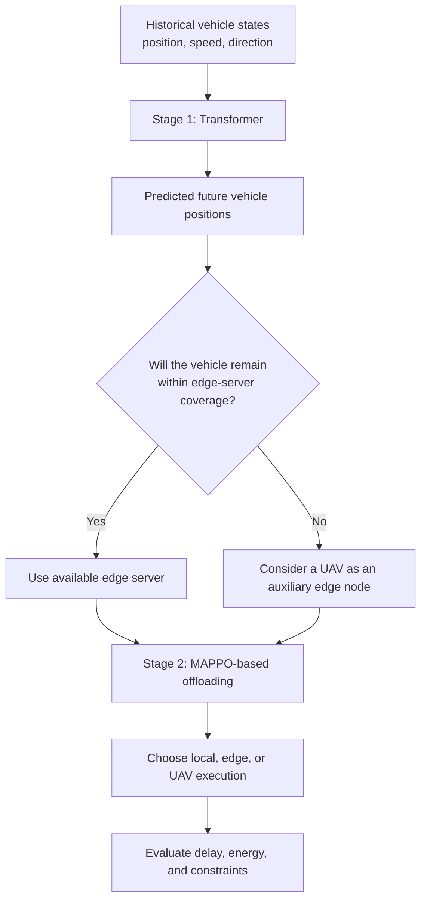

# Paper 01 — Mobility-Aware Task Offloading in UAV-MEC-Assisted IoV

> **Research area:** Internet of Vehicles (IoV) · Mobile Edge Computing (MEC) · UAV-assisted networks · Mobility prediction · Multi-agent reinforcement learning
>
> **Reading type:** Structured literature review and technical study notes

## Paper at a glance

| Item | Details |
|---|---|
| Title | *Mobility-aware task offloading in UAV-MEC-assisted IoV: A two-stage approach* |
| Authors | Kai Peng, Yuanlin Lin, Xiaolong Xu, Kunkun Yue, and Victor C. M. Leung |
| Journal | *Ad Hoc Networks*, Volume 178, Article 103956 |
| Publication year | 2025 |
| DOI | [10.1016/j.adhoc.2025.103956](https://doi.org/10.1016/j.adhoc.2025.103956) |
| Proposed method | Efficient Computation Offloading Method for MEC-enabled Highly-Mobility IoV (ECMHI) |

## The paper in one paragraph

The paper studies how connected vehicles can execute delay-sensitive computational tasks when their positions change rapidly and nearby edge servers have limited coverage and computing resources. It proposes a three-tier computing environment containing vehicles, roadside/edge servers, and UAVs. Its solution has two linked stages: a Transformer predicts future vehicle positions from historical position, speed, and direction information; then a MAPPO-based multi-agent reinforcement-learning method uses the predicted mobility information to make task-offloading decisions. The system aims to reduce both task delay and energy consumption while respecting computing-capacity, timing, and UAV-energy constraints.

## Why this problem matters

A vehicle may leave an edge server's coverage area while a task is being uploaded or processed. Repeated handovers can increase delay or cause an offloading attempt to fail. A UAV can act as an additional mobile edge node, but it needs to be sent to a useful location in time and must have enough energy and computing capacity. The authors therefore use **prediction before offloading** rather than relying only on the vehicle's current position.

## Proposed approach at a glance

The key division of responsibilities is:

- **Transformer:** estimates where a vehicle is likely to be in the future.
- **MAPPO:** learns how vehicles should make offloading decisions given the system state and predicted mobility.

## What to read in this folder

| File | Purpose |
|---|---|
| [`concept-notes.md`](concept-notes.md) | Plain-language explanations of the paper's core concepts and terminology |
| [`methodology.md`](methodology.md) | System model, two-stage workflow, MDP design, and constraints |
| [`technical-deep-dive.md`](technical-deep-dive.md) | Important equations, symbols, and algorithm-level details |
| [`experiments-and-results.md`](experiments-and-results.md) | Datasets, baselines, experimental setup, and reported result trends |
| [`limitations-and-insights.md`](limitations-and-insights.md) | Author-stated future work, assumptions, critical observations, and open questions |
| [`interview-prep.md`](interview-prep.md) | Short explanations and likely technical interview questions |
| [`learning-journal.md`](learning-journal.md) | Space to rewrite the concepts in your own words and track confidence |
| [`references.md`](references.md) | Full paper citation and source notes |

## Main takeaways

1. Mobility prediction can support proactive network decisions: the system can prepare for a vehicle's future location rather than reacting only after it moves out of coverage.
2. The proposed architecture combines a **Transformer-based prediction stage** with a **MAPPO-based decision stage**.
3. Offloading is not simply a choice of the fastest processor. The decision must account for computation time, transmission time, available computing resources, and energy use.
4. The paper evaluates prediction and offloading separately, using different baselines for each stage.
5. The reported results favour the proposed combined method in the tested settings, but the paper also relies on modeling assumptions and a synthetic vehicular 5G dataset for the offloading stage.

## Scope and attribution

This folder is an independent reading and analysis of the published paper. It is **not** the original research, an implementation of ECMHI, or a reproduction of the authors' experiments. The method, datasets, and reported findings described here are attributed to the paper. Interpretations and questions in the critical-analysis files are reading notes, not claims made by the authors.

The publisher's PDF is not included in this repository. Refer to the DOI above for the original publication and its access terms.
