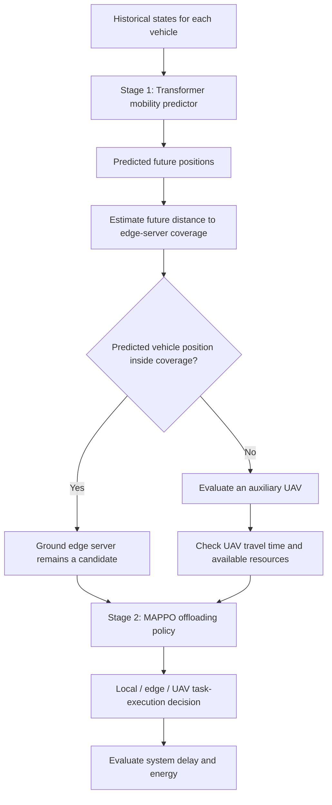

# Methodology — Paper 01

## 1. Research objective

The paper studies computation offloading for delay-sensitive applications in high-mobility Internet of Vehicles (IoV) scenarios supported by Mobile Edge Computing (MEC). The objective is to make offloading decisions that account for changing vehicle positions while reducing system delay and energy consumption under resource and timing constraints.

## 2. Three-tier system model

The proposed network contains three types of entities:

| Entity | Role in the system | Relevant modeled information |
|---|---|---|
| Local vehicles | Generate tasks and can execute tasks locally | Position, speed, direction, computing resources, energy-related coefficient |
| Ground edge servers | Provide nearby computing resources | Position, coverage radius, computing resources, energy-related coefficient, bandwidth |
| UAVs | Act as mobile auxiliary edge-computing nodes | Position, speed, coverage radius, computing resources, energy-related coefficient, bandwidth |

The model includes multiple vehicles, edge servers, and UAVs. A vehicle's task may be executed locally or offloaded to an eligible edge server or UAV.

## 3. Overall two-stage method

The paper calls the complete method **ECMHI** (Efficient Computation Offloading Method for MEC-enabled Highly-Mobility IoV).

## 4. Stage 1 — Vehicle mobility prediction

### 4.1 Input and output

The Transformer receives a historical sequence of vehicle states:

\[
S = [(p_1,v_1,d_1),\ldots,(p_T,v_T,d_T)],
\]

where \(p_t\) is position, \(v_t\) is speed, and \(d_t\) is direction at time \(t\).

It predicts a sequence of future positions:

\[
P_{future}=[p_{T+1},\ldots,p_{T+k}],
\]

where \(k\) is the prediction horizon.

### 4.2 Transformer processing described by the paper

1. Initialize model parameters, including the number of attention heads, hidden size, and number of layers.
2. Generate positional encodings for the input sequence.
3. Embed each historical state and combine it with its positional encoding.
4. Process the sequence through Transformer layers using multi-head attention and feed-forward layers.
5. Decode/predict future states and return the predicted vehicle positions.

The paper explains that self-attention captures relationships across the input sequence and positional encoding supplies information about sequence order.

### 4.3 How predicted mobility is used

The predicted future position is compared with the coverage radius of the ground edge server.

- If the predicted vehicle position remains within the edge server's coverage, the task can be offloaded to that server under the paper's decision model.
- If the predicted position is outside the coverage, a UAV is considered as an auxiliary edge node. The UAV is planned to move toward the predicted position.

The paper calculates UAV travel time from the distance to the predicted vehicle position and the UAV's speed. The UAV must reach the vehicle before the vehicle leaves the relevant edge-server coverage area. Resource and UAV-energy constraints must also be met.

## 5. Stage 2 — MAPPO-based computation offloading

### 5.1 MDP formulation

The paper models the interaction as a Markov Decision Process.

| MDP element | Paper's definition |
|---|---|
| Global state \(S\) | \(S=\{V,T,M,U\}\): vehicle set, task set, edge-server set, and UAV set |
| Agent observation \(O_i\) | Information for one vehicle, including its task, position, speed, direction, computing-resource information, and energy-consumption coefficient |
| Action \(A\) | Offloading choices made by vehicles; the paper represents the joint action across vehicles |
| Reward \(R\) | A global reward based on the weighted sum of total task delay and total energy consumption, with a negative sign so lower cost gives higher reward |

### 5.2 Actor-Critic roles

- **Actor network:** Selects an offloading action from an agent's observation.
- **Critic network:** Estimates value using the global system state.
- **Advantage estimate:** Uses the return and the Critic's value estimate to evaluate an action.
- **Policy update:** Uses a clipped policy objective to limit the magnitude of updates.
- **Value update:** Trains the Critic by reducing the difference between the return and its estimated state value.

This is a centralized-training/decentralized-decision pattern as described in the paper: the Critic has global-state information, while an individual agent's action is based on its observation.

### 5.3 Reward design

The global reward penalizes the weighted total delay and total energy consumption:

\[
R=-\left(\alpha\sum_{n=1}^{N_1}T_n^{total}+\beta\sum_{n=1}^{N_1}E_n^{total}\right),
\qquad \alpha+\beta=1.
\]

The weights \(\alpha\) and \(\beta\) control the relative importance assigned to delay and energy in the reward.

## 6. Objective and constraints

The paper formulates a multi-objective problem to minimize total delay and total energy consumption. The solution must satisfy the following categories of constraints:

| Constraint | Meaning |
|---|---|
| \(C_0\): timing | Task delay must stay below the maximum delay threshold, and the UAV must reach the vehicle before the relevant coverage window closes |
| \(C_1\): computing capacity | Total allocated computing resources cannot exceed the capacity of the vehicle, edge server, or UAV |
| \(C_2\): UAV selection | Among UAVs satisfying travel-time requirements, the model considers the UAV with the greatest available computing resources |
| \(C_3\): UAV energy | Computation/offloading and UAV movement must respect the available UAV energy budget |

These are not optional preferences: the paper treats the task-resource conditions as hard constraints for successful task execution.

## 7. Experimental evaluation design

### Stage 1: mobility prediction

- Dataset: NGSIM Vehicle Trajectories and Supporting Data.
- Training samples: 431,204.
- Evaluation samples: 32,463.
- Test samples: 26,594.
- Models compared: Transformer, LSTM, GRU, and RNN.
- The paper evaluates prediction loss and position-prediction error.

### Stage 2: computation offloading

- Dataset: Synthetic Vehicular 5G Dataset.
- Compared methods: ECMHI, MAPPO, COMA, and MATD3.
- The dataset includes task sizes, vehicle/edge/UAV locations, and computing-resource information.
- Evaluation includes training reward, system delay, and energy consumption. The paper also compares average delay and energy for different task sizes and reports results based on more than 50 experiments in the same environment.

The paper states that the experiments were processed in Python on a Windows 10 64-bit system with an Intel Core i7-9750H 2.60 GHz processor and 16 GB RAM.

## 8. End-to-end methodology summary

1. Collect historical vehicle position, speed, and direction data.
2. Use the Transformer to predict future vehicle locations.
3. Determine whether the vehicle is expected to remain inside a ground edge server's coverage.
4. If needed, evaluate a UAV's ability to reach the vehicle in time and satisfy resource/energy constraints.
5. Supply the predicted mobility information and system observations to the MAPPO-based offloading framework.
6. Let the vehicle agents choose local, edge-server, or UAV execution.
7. Evaluate reward and system performance using delay and energy, while maintaining the stated constraints.

**Core methodological insight:** The prediction stage informs the optimization stage. The paper's contribution is not simply using a Transformer and MAPPO separately; it connects predicted mobility to proactive task-offloading decisions in a UAV-assisted IoV setting.
