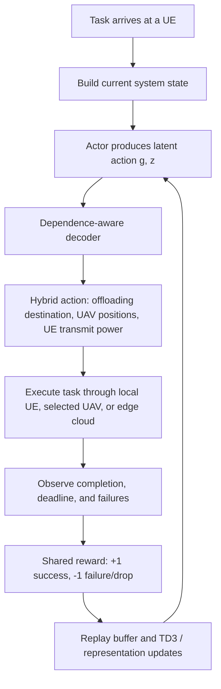

# Paper 02 — Reliability-Aware Optimization of Task Offloading for UAV-Assisted Edge Computing

> **Research areas:** UAV-assisted mobile edge computing (MEC) · Reliable task offloading · Deep reinforcement learning · Hybrid action representation
>
> **Reading type:** Structured literature review and independent technical analysis

## Paper at a glance

| Item | Details |
|---|---|
| Title | *Reliability-Aware Optimization of Task Offloading for UAV-Assisted Edge Computing* |
| Authors | Hao Hao, Changqiao Xu, Wei Zhang, Xingyan Chen, Shujie Yang, and Gabriel-Miro Muntean |
| Journal | *IEEE Transactions on Computers*, Vol. 74, No. 11 |
| Issue | November 2025 |
| DOI | [10.1109/TC.2025.3604463](https://doi.org/10.1109/TC.2025.3604463) |
| Proposed scheme | Task-driven Reliability-aware Offloading (TRO) |
| Main learning method | Dependence-aware latent-space representation combined with Twin Delayed Deep Deterministic Policy Gradient (TD3) |
| Paper licence | Creative Commons Attribution 4.0 (CC BY 4.0), as stated in the article |

## The paper in one paragraph

This paper studies cooperative task offloading in a multi-UAV-assisted edge-computing network. A user equipment (UE) can process a task locally, send it to one of several UAVs, or offload it to an edge-cloud (EC) server. The authors argue that optimizing delay alone is insufficient because tasks can fail when a UAV or a wireless transmission link fails. They propose a **task-driven reliability-aware** scheme that makes a decision when each task arrives, models both computing-node and transmission-link reliability, and jointly optimizes the offloading destination, UAV positions, and UE transmission power. Because these decisions combine discrete and continuous variables, the authors introduce a dependence-aware latent representation based on a learned discrete-action embedding and a conditional variational auto-encoder (VAE), then combine it with TD3 to form the TRO algorithm. The objective is to maximize the long-term average task success rate.

## The research problem

Conventional cloud-only processing can introduce high transmission delay. Fixed ground edge infrastructure may be unavailable, overloaded, or damaged in emergency and infrastructure-poor scenarios. UAVs can provide flexible aerial computing and communication support, but they have limited energy and computing capacity and can themselves fail. Wireless links can also fail. A task may therefore miss its deadline or fail during execution or transmission even when its nominal processing time looks acceptable.

The authors identify two gaps in prior work:

1. Many offloading methods are **time-driven**: they wait for a time-slot boundary before making decisions, which can introduce decision-waiting delay and repeated decisions for all active tasks.
2. Many methods focus on delay or energy without explicitly optimizing the probability that tasks are successfully completed under UAV and link unreliability.

## Proposed approach at a glance

The proposed TRO pipeline has two key ideas:

- **Task-driven control:** make an offloading decision as soon as a new task arrives rather than waiting for the end of a fixed time slot.
- **Reliability-aware hybrid-action learning:** model the success/failure risk and learn a joint decision over discrete destinations and continuous control variables.

## What is being optimized?

The paper jointly considers:

- **Offloading destination:** local UE, one of the UAVs, or the edge-cloud server.
- **UAV mobility:** 3D UAV positions, subject to movement, collision-separation, and energy constraints.
- **UE transmission power:** continuous power control for offloaded tasks.

The objective is to maximize the **long-term average task success rate**, rather than minimize average task delay alone. A task is considered successful when it completes before its deadline and execution and transmission are error-free under the reliability model.

## What to read in this folder

| File | Purpose |
|---|---|
| [`concept-notes.md`](concept-notes.md) | Plain-language explanations of the system, reliability, task-driven control, MDP, VAE, and TD3 |
| [`methodology.md`](methodology.md) | Network model, task lifecycle, reliability model, optimization variables, and TRO workflow |
| [`technical-deep-dive.md`](technical-deep-dive.md) | Important equations, notation, hybrid-action representation, TD3 losses, and complexity |
| [`experiments-and-results.md`](experiments-and-results.md) | Simulation setup, baselines, result trends, and Kubernetes testbed |
| [`limitations-and-insights.md`](limitations-and-insights.md) | Author-stated limitations/future work separated from independent critical observations |
| [`interview-prep.md`](interview-prep.md) | A concise paper pitch and technical interview questions with answer points |
| [`learning-journal.md`](learning-journal.md) | Revision prompts and a checklist to complete in your own words |
| [`references.md`](references.md) | Original citation, DOI, licence, and key background references |

## Main takeaways

1. **A task can be fast but still fail.** Completion time, deadline feasibility, computing-node reliability, and transmission-link reliability all matter.
2. The paper uses a **task-arrival event** to trigger decisions, instead of fixed periodic time slots.
3. The optimization action is hybrid: a discrete destination choice plus continuous UAV-position and UE-transmit-power variables.
4. The authors learn a dependence-aware latent representation so that discrete and continuous action components can be handled together by a TD3-style continuous policy learner.
5. The reported simulation and Kubernetes-testbed results show higher task-success performance for TRO than the compared approaches in the tested settings. The paper does not provide a single universal success-rate value; results vary with workload, task size, deadlines, number of UEs/UAVs, and failure rates.

## Relationship to Paper 01 in this portfolio

Both papers study UAV-assisted edge computing and task offloading, but they address different bottlenecks:

| Dimension | Paper 01 — ECMHI | Paper 02 — TRO |
|---|---|---|
| Main challenge | Vehicle mobility can make a fixed edge server unavailable during task execution | UAV and wireless-link failures can make a task unsuccessful |
| Trigger / temporal model | Uses predicted future vehicle positions before offloading | Makes a decision on each task arrival |
| Main learned components | Transformer for mobility prediction + MAPPO for offloading | Dependence-aware latent action representation + TD3 |
| Main decision variables | Offloading decisions informed by future vehicle mobility | Offloading destination, UAV 3D positions, UE transmit power |
| Main optimization emphasis | Delay and energy consumption | Long-term task success rate, with delay and energy as constraints/decision factors |
| Evaluation described | NGSIM-based mobility prediction, synthetic vehicular 5G offloading data | Simulations and a Kubernetes/TCP-IP testbed |

The papers are related by domain, but **Paper 02 is not an extension or reproduction of Paper 01**. Their assumptions, system models, algorithms, and optimization objectives differ.

## Scope and attribution

This folder is an independent reading and analysis of the published article. It is **not** the original research, an implementation of TRO, or a reproduction of the authors' experiments. Method descriptions and reported results are attributed to the authors. Critical observations and interview explanations are study notes and should not be presented as claims made by the authors.

The original publication is linked through its DOI. The paper states that it is licensed under CC BY 4.0; consult the licence and publisher page before redistributing the article itself. The PDF supplied for this reading project is not copied into this folder.
