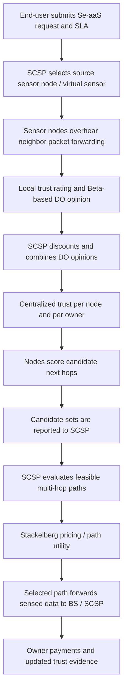

# Paper 03 — Dynamic Trust Enforcing Pricing Scheme for Sensors-as-a-Service in Sensor-Cloud Infrastructure

> **Research areas:** Wireless sensor networks · Sensor-cloud · Sensors-as-a-Service (Se-aaS) · Trust and reputation systems · Game theory · Dynamic pricing · Multi-hop routing
>
> **Reading type:** Structured literature review and independent technical analysis

## Paper at a glance

| Item | Details |
|---|---|
| Title | *Dynamic Trust Enforcing Pricing Scheme for Sensors-as-a-Service in Sensor-Cloud Infrastructure* |
| Authors | Aishwariya Chakraborty, Ayan Mondal, Arijit Roy, and Sudip Misra |
| Journal | *IEEE Transactions on Services Computing*, vol. 14, no. 5, pp. 1345–1356 |
| Publication | September/October 2021 issue |
| DOI | [10.1109/TSC.2018.2873763](https://doi.org/10.1109/TSC.2018.2873763) |
| Proposed scheme | DETER — Dynamic Trust Enforcing Pricing Scheme |
| Main mechanisms | Bi-level trust calculation + dynamic pricing using a Single-Leader-Multiple-Follower Stackelberg game |
| Evaluation | MATLAB simulation comparing DETER with DOP and TERP |

> **Version note:** The supplied PDF is marked as a preprint. The journal, volume, issue, page range, year, and DOI above are identified from the publication record, rather than inferred from the PDF's preprint watermark.

## The paper in one paragraph

This paper studies how a Sensor-Cloud Service Provider (SCSP) can deliver reliable **Sensors-as-a-Service (Se-aaS)** when sensor nodes are owned by multiple competing parties. Sensor-cloud allows users to obtain sensing services without purchasing and operating their own wireless sensor networks. However, sensed data often travels through multi-hop routes containing intermediate nodes owned by different sensor-owners. A selfish owner may intentionally mishandle packets or undermine another owner's reputation, lowering service quality and potentially creating a market advantage for dishonest owners. The authors propose **DETER**, which combines local, distributed trust opinions about neighboring sensor nodes with centralized trust opinions about sensor-owners. The SCSP then uses a Stackelberg pricing game to reward trustworthy participation and discourage selfish behavior, while selecting a trust-aware route that satisfies the service delay requirement. The paper evaluates the scheme in simulation against DOP and TERP.

## The research problem

The sensor-cloud model separates the end-user from the physical sensor infrastructure:

- Sensor-owners deploy and own heterogeneous wireless sensor nodes.
- The SCSP registers those nodes, forms virtual sensors/services, manages service requests, and pays owners for sensing and relaying.
- End-users request a service under a Service Level Agreement (SLA), including a maximum tolerable delay and price.
- Source sensor nodes send data to the base station (BS) through multi-hop routes. Intermediate nodes may belong to different owners.

This creates a trust and incentive problem. A selfish owner may make its nodes forward data incorrectly or otherwise behave unfairly, which can harm the sensed-data path, the QoS delivered to end-users, the reputation of honest owners, and the SCSP's profit.

## What is new in DETER?

DETER has two connected components:

1. **Bi-level trust calculation.** Each sensor node periodically estimates trust in its neighboring nodes (distributed opinion, DO). The SCSP combines node opinions to calculate centralized opinions (CO) for individual nodes and then aggregates them at sensor-owner level.
2. **Game-theoretic dynamic pricing and route selection.** Nodes rank candidate next hops using physical/link factors, residual energy, trust, and the cost of selecting an owner. The SCSP selects a suitable end-to-end path using path utility and decides the payments to owners using a Single-Leader-Multiple-Follower Stackelberg game.

The intended incentive is to make honest behavior economically preferable while preserving both service quality and a viable profit for the SCSP.

## DETER workflow

## Main findings reported by the authors

The paper reports that, under its simulation settings, DETER:

- reduces network overhead by **52.6–56.53% compared with TERP**;
- explores **76.57–86.47% fewer nodes than TERP** during path exploration;
- increases the percentage of correctly forwarded packets by **0.23–0.62 percentage points compared with DOP** and **0.27–0.56 percentage points compared with TERP**;
- reduces the average number of selfish nodes in a selected path by **35.61–52.72% compared with DOP** and **26.43–61.37% compared with TERP**;
- improves average path length by **10.87–23.21% compared with TERP**;
- reports a **4.69–11.56% energy-related improvement** in its abstract/results discussion; and
- reports up to **50.15%** and **73.9%** higher SCSP profit than DOP and TERP, respectively, in the evaluated settings.

These are paper-reported comparative results, not universal guarantees. The exact comparison and metric definitions are recorded in [`experiments-and-results.md`](experiments-and-results.md).

## What to read in this folder

| File | Purpose |
|---|---|
| [`concept-notes.md`](concept-notes.md) | Sensor-cloud, Se-aaS, trust opinions, Beta reputation, and Stackelberg game explained |
| [`methodology.md`](methodology.md) | System architecture and DETER's four-stage workflow |
| [`technical-deep-dive.md`](technical-deep-dive.md) | Trust equations, utility functions, price logic, and equilibrium concepts |
| [`experiments-and-results.md`](experiments-and-results.md) | Simulation setup, baselines, metrics, and numerical findings |
| [`limitations-and-insights.md`](limitations-and-insights.md) | Author-stated future work and independent critical observations |
| [`interview-prep.md`](interview-prep.md) | Paper pitch and technical questions with answer frameworks |
| [`learning-journal.md`](learning-journal.md) | Revision checklist and prompts for personal reflection |
| [`references.md`](references.md) | Primary citation, DOI, and selected foundational references |

## Main takeaways

1. **Trust is both a technical and an economic problem.** Node forwarding behavior affects data quality, while owner-level incentives affect whether that behavior is likely to continue.
2. **Trust is estimated at two levels.** Nodes monitor neighboring nodes locally; the SCSP aggregates opinions into owner-level trust.
3. **Routing and pricing are coupled.** Selecting a next hop affects route quality and the price paid to the owner whose node is selected.
4. **The SCSP is the Stackelberg leader.** Sensor-owners are followers who respond to the pricing and selection mechanism.
5. **The evaluation is simulation-based.** The results support the scheme under the paper's model and parameters; the supplied article does not report an outdoor sensor-network deployment.

## Relationship to the other papers in this portfolio

Unlike Papers 01 and 02, which study task offloading in UAV-assisted edge-computing systems, Paper 03 studies trust-aware routing and pricing in a service-oriented wireless sensor-cloud. The connection is broader: all three examine how distributed network resources should be selected and coordinated under constraints. Paper 03 adds an economic and reputation-based perspective rather than another UAV trajectory or task-offloading algorithm.

## Scope and attribution

This folder contains independent reading notes and technical explanations of the original paper. DETER, its trust model, utility functions, game formulation, and reported experiments belong to the paper's authors. These notes do not claim authorship of DETER, reproduce the authors' implementation, or independently verify the numerical results. The provided PDF refers readers to a supplementary file for detailed pseudocode and some operator calculations; those details are not invented here where they are not present in the supplied article.
