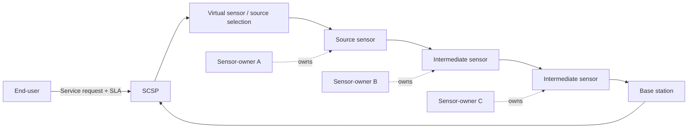
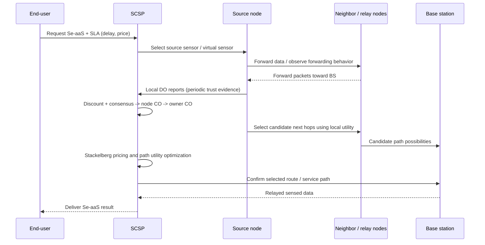

# Methodology — Paper 03

## 1. System architecture

The paper studies a service-oriented sensor-cloud infrastructure with four main participant types:

1. **End-users:** request a sensing service and specify its requirements through an SLA.
2. **Sensor-Cloud Service Provider (SCSP):** registers heterogeneous sensors, composes virtual sensors, coordinates service delivery, chooses paths, and manages payments.
3. **Sensor-owners:** own one or more sensor nodes and receive payments when their nodes participate in a selected service path.
4. **Sensor nodes:** sense data, forward packets over multi-hop routes, and observe the forwarding behavior of neighboring nodes.

The source node sends data towards the base station (BS) using a path containing intermediate sensors. The selected intermediate nodes may belong to other sensor-owners. After reaching the BS, the sensed data is relayed to the cloud for processing and service delivery.

### System model sketch

The diagram is conceptual; the paper allows multiple candidate routes and does not restrict a path to exactly two intermediate nodes.

## 2. Service and network assumptions

The paper states the following assumptions for DETER:

- The SCSP is a centralized entity responsible for maintaining the dynamic pricing policy.
- Source nodes selected by the SCSP transmit sensed data to the cloud using different paths.
- Intermediate nodes do not aggregate data; they relay it.
- Each node knows which sensor nodes belong to the same sensor-owner.
- Each node can overhear neighbor transmissions while it is active or idle.

The SCSP uses a dynamic pay-per-use model. The end-user's SLA includes the service type, maximum tolerable delay (`δ`), and maximum price (`Pmax`). The SCSP composes virtual sensors from subsets of registered physical sensors to meet the user request.

## 3. Component A — Distributed trust opinion (DO)

Each sensor node periodically estimates trust in its neighboring nodes.

1. The node overhears transmissions and counts how many packets a neighbor forwarded correctly (`F`) out of the total packets sent to that neighbor (`T`).
2. It derives an instantaneous positive/negative feedback pair from the trust rating.
3. It updates cumulative positive and negative feedback using a forgetting factor.
4. It converts those cumulative values into belief, disbelief, and uncertainty using the Beta reputation model.
5. The resulting DO opinion is used as evidence for next-hop candidate selection.

The paper assumes a node belonging to the same owner as the observer is assigned a trust rating of 1. This is a modeling assumption, not an independently verified property of those nodes.

## 4. Component B — Centralized trust opinion (CO)

The SCSP creates a centralized trust opinion for each registered sensor node and then aggregates node opinions at owner level.

1. At the initial time, the SCSP initializes each node's CO to `(1, 0, 0, 0.5)`.
2. It periodically receives DO reports from sensor nodes.
3. It discounts the previous centralized opinion using a discounting operator and the incoming DO evidence.
4. It combines independent discounted opinions using a consensus operator.
5. For each sensor-owner, it averages the CO values of the nodes owned by that owner to obtain an owner-level opinion.

The detailed algebra of discounting and consensus operators is referred to a supplementary file in the paper. The supplied PDF does not include that supplementary derivation, so these notes describe the sequence without inventing missing operator details.

## 5. Component C — Candidate next-hop selection

Each node calculates a utility for every neighbor. The utility is the difference between:

- a **virtual revenue** term based on residual energy, RSS, SNR, and the neighbor's distributed trust expectation; and
- a **virtual cost** term based on the pseudo-price associated with the neighbor's owner and the neighbor's distance to the BS relative to the current node.

A candidate must also satisfy minimum thresholds for residual energy, received signal strength, and SNR, and must not be farther from the BS than the current node under the paper's stated distance constraint. The node forms a candidate set of next-hop nodes. The SCSP determines the allowed candidate-set cardinality.

## 6. Component D — SCSP path selection and dynamic pricing

For each service request, the SCSP evaluates candidate routes from source node to BS.

- The maximum tolerable service delay limits the number of nodes/hops in the selected path. The paper assumes one unit of delay per hop.
- The path utility accounts for hardware cost, the user's maximum price, and the cumulative trust opinions of owners represented in the path.
- The SCSP chooses the feasible path with the maximum path utility.
- Payments to sensor-owners are related to their centralized trust expectation. More trusted owners can receive more favorable payment/selection outcomes.
- The game is modeled as a Single-Leader-Multiple-Follower Stackelberg game: the SCSP is the leader, sensor-owners are followers.

## 7. The four algorithms described by the paper

| Algorithm | Responsibility | Main output |
|---|---|---|
| Algorithm 1 | Each sensor node calculates distributed opinions for its neighbors | DO sets |
| Algorithm 2 | SCSP aggregates node opinions and computes owner opinions | CO sets for nodes and sensor-owners |
| Algorithm 3 | Source and intermediate nodes evaluate neighboring nodes | Candidate next-hop set |
| Algorithm 4 | SCSP evaluates paths and optimizes the trust-aware pricing/selection decision | Selected path and owner payment decisions |

The article says the detailed pseudocodes for Algorithms 1–4 are in a supplementary file. That supplementary file was not part of the supplied PDF.

## 8. End-to-end workflow

This sequence is a learning aid that combines the paper's distributed trust, centralized trust, route selection, and game-theoretic pricing stages. It is not a literal packet-level protocol specification.

## 9. What the methodology is designed to achieve

DETER tries to align three objectives that can otherwise conflict:

- protect the correctness of sensed-data forwarding and the end-user's QoS;
- discourage sensor-owners from gaining an advantage through selfish behavior; and
- maintain positive and meaningful returns for both the SCSP and sensor-owners.

The paper's main optimization mechanism is therefore socio-technical: it combines network metrics with reputation and economic incentives.
